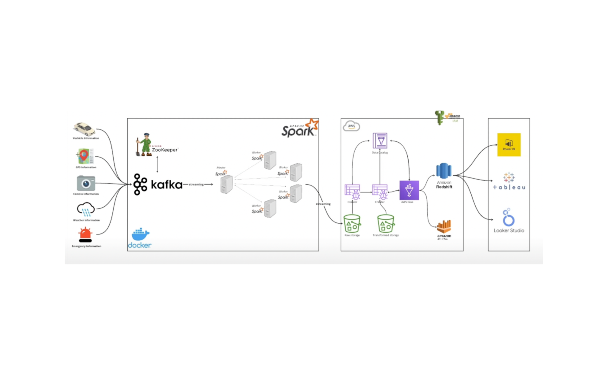
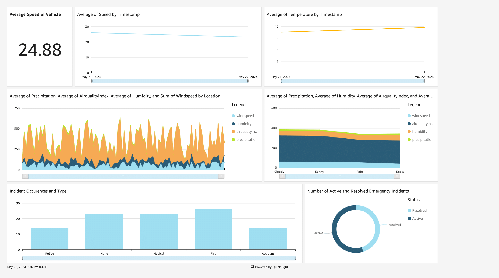

# Smart City End-to-End Real-Time Data Streaming Pipeline



## Project Overview

This project implements a scalable, production-grade real-time data streaming pipeline for Smart City initiatives. It simulates and streams real-time telemetry from vehicles traveling from London to Birmingham—including vehicle status, GPS tracking, traffic camera feeds, weather metrics, and emergency incidents. 

The architecture combines IoT simulation, Apache Kafka, Apache Spark Streaming, Docker, and AWS services (S3, Glue, Athena, and QuickSight) to ensure high-throughput ingestion, distributed processing, structured Parquet storage, and interactive analytics.

---

## Architecture



```
[IoT Data Simulator]
        │
        ▼ (JSON messages)
[Apache Kafka & Zookeeper (Docker)]
  ├── vehicle_data
  ├── gps_data
  ├── traffic_data
  ├── weather_data
  └── emergency_data
        │
        ▼ (Structured Streaming)
[Apache Spark Cluster 3.5.1]
  ├── Schema validation & Watermarking
  └── Checkpointed Parquet Stream Writer
        │
        ▼ (s3a://)
[Amazon S3 Data Lake]
        │
        ▼
[AWS Glue Data Catalog & Crawlers]
        │
        ▼
[Amazon Athena (Ad-hoc SQL)]
        │
        ▼
[Amazon QuickSight (BI Dashboards)]
```

---

## Technologies Used

- **IoT Data Simulation**: Python-based telemetry generator producing realistic spatial-temporal trip data.
- **Apache Kafka & Zookeeper**: Distributed streaming platform for fault-tolerant data ingestion across multiple topics.
- **Apache Spark (v3.5.1)**: Distributed streaming engine running Spark Structured Streaming with S3A connectors.
- **Docker & Docker Compose**: Containerization and local orchestration of Kafka brokers, Zookeeper, Spark master, and Spark workers.
- **Python**: Application logic using `confluent-kafka`, `pyspark`, and `simplejson`.
- **AWS Cloud**:
  - **Amazon S3**: High-durability data lake storing processed partitioned Parquet files.
  - **AWS Glue**: Schema discovery, metadata cataloging, and crawler orchestration.
  - **Amazon Athena**: Serverless interactive SQL analytics engine over S3 Parquet tables.
  - **AWS IAM**: Role-based access control and least-privilege security credentials.
- **Amazon QuickSight**: Cloud-native BI service providing interactive real-time visual dashboards.

---

## Project Structure

```text
├── jobs/
│   ├── config.py           # Dynamic configuration & .env auto-loader
│   ├── main.py             # IoT device simulator producing to Kafka
│   └── spark-city.py       # Spark Structured Streaming job to S3
├── docker-compose.yml       # Docker orchestrator for Kafka, Zookeeper, & Spark
├── requirements.txt         # Python dependencies
├── .env.example             # Template for required environment variables
├── .gitignore               # Excludes secrets, bytecode, and virtual environments
├── SysArch.png              # System architecture diagram
├── Analysis-1.png           # QuickSight dashboard screenshot
├── ERD Diagram.pdf          # Entity-Relationship diagram
└── README.md
```

---

## Getting Started

### Prerequisites

- **Docker Desktop** (with Docker Compose enabled)
- **Python 3.9+** (Python 3.10 / 3.11 recommended)
- **AWS Account** with an S3 bucket and IAM credentials with write access to S3.

---

### Setup Instructions

#### 1. Clone the Repository
```bash
git clone https://github.com/nrahil/Smart-City-Real-Time-Data-Engineering.git
cd Smart-City-Real-Time-Data-Engineering
```

#### 2. Configure Environment Variables
Create your local `.env` file from the provided `.env.example`:

```bash
cp .env.example .env
```

Open `.env` and fill in your actual AWS credentials, bucket name, and Kafka broker address:
```ini
AWS_ACCESS_KEY=your_aws_access_key_id
AWS_SECRET_KEY=your_aws_secret_access_key
KAFKA_BOOTSTRAP_SERVERS=broker:29092
S3_BUCKET=your-s3-bucket-name
```
> **Security Notice**: `.env` is ignored by Git to prevent accidental leaks. Do not commit secrets to source control.

#### 3. Install Python Dependencies (Virtual Environment)
```bash
python -m venv .venv
# On Windows:
.venv\Scripts\activate
# On Linux/macOS:
source .venv/bin/activate

pip install -r requirements.txt
```

#### 4. Start Infrastructure with Docker
Spin up Zookeeper, the Kafka broker, Spark Master, and Spark Workers:
```bash
docker compose up -d
```

Verify that all containers are healthy:
```bash
docker compose ps
```

Access Web UIs:
- **Spark Master UI**: [http://localhost:9090](http://localhost:9090) (or port 8080 depending on mapping)

---

### Running the Streaming Pipeline

#### Step 1: Submit the Spark Streaming Job
Run the Spark job inside the Spark master container:
```bash
docker exec -it smartcityproject-spark-master-1 spark-submit \
  --master spark://spark-master:7077 \
  --packages org.apache.spark:spark-sql-kafka-0-10_2.12:3.5.1,org.apache.hadoop:hadoop-aws:3.3.1,com.amazonaws:aws-java-sdk:1.11.469 \
  jobs/spark-city.py
```
*Alternatively, if running locally outside Docker with PySpark:*
```bash
python jobs/spark-city.py
```

#### Step 2: Start the IoT Data Generator
In a separate terminal window, launch the vehicle telemetry simulator:
```bash
python jobs/main.py
```
This generates real-time telemetry along the London-to-Birmingham route and streams it to Kafka topics:
- `vehicle_data`
- `gps_data`
- `traffic_data`
- `weather_data`
- `emergency_data`

---

### AWS Analytics & Visualization

1. **Verify S3 Buckets**: Confirm that Parquet files and checkpoints are being written to `s3://<your-s3-bucket>/data/` and `s3://<your-s3-bucket>/checkpoints/`.
2. **AWS Glue Crawler**: Set up an AWS Glue Crawler targeting your S3 data path to automatically discover schemas and populate the Glue Data Catalog.
3. **Query with Amazon Athena**: Execute SQL queries on the cataloged tables to inspect speeds, traffic, weather, and incidents.
4. **Visualize with Amazon QuickSight**:
   - Connect QuickSight to Athena as the data source.
   - Build dashboards with:
     - **KPI Cards**: Average vehicle speed, total incidents, active vehicle count.
     - **Time-Series Charts**: Traffic density and weather patterns over time.
     - **Geospatial Maps**: Route trajectories and GPS heat maps.

---

## Key Improvements & Bug Fixes in This Version

- **Dynamic Environment Configuration**: Replaced hardcoded keys with seamless `.env` loading in `config.py` and `docker-compose.yml`.
- **GPS Schema Fix**: Added missing `location` field in `gpsSchema` in `spark-city.py` to align with the generator payload.
- **Multi-Stream Termination**: Updated `spark.streams.awaitAnyTermination()` so all 5 concurrent streaming queries remain active.
- **Spark & Kafka Version Alignment**: Upgraded Docker images to `bitnamilegacy/spark:3.5.1` and updated `confluent-kafka>=2.6.0` to eliminate runtime compatibility issues.

---

## License

This project is licensed under the MIT License - see the LICENSE file for details.
